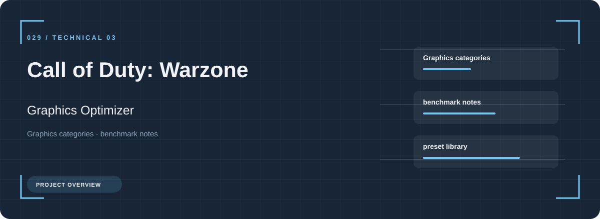
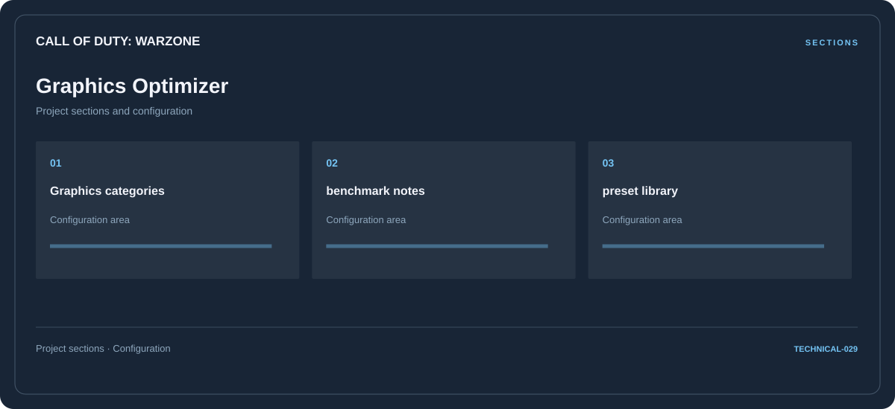

# 🎮 Call of Duty: Warzone Graphics Optimizer

**Graphics categories · Benchmark notes · Preset library**

## ⚡ Features

Graphics categories, benchmark notes, and preset library form the core of Call of Duty: Warzone Graphics Optimizer. Related configuration is grouped by task rather than collected in an undifferentiated list.

### ⚙️ Graphics categories

Display or performance-related options, with space for configuration and comparison information.

### 🧩 Benchmark notes

Display or performance-related options, with space for configuration and comparison information.

### ⌨️ Preset library

Related settings collected into named groups for a clearer configuration workflow.

## 🖥️ Project navigation

## 📥 Download

The button and cover open the project's download page. Use the information supplied with the downloaded package for installation and release-specific requirements.

## 📚 Project documentation

- [Feature reference](docs/FEATURES.md)
- [Download information](docs/DOWNLOAD.md)
- [Project page](index.html)

---

Call of Duty: Warzone Graphics Optimizer · Program documentation and download information.
